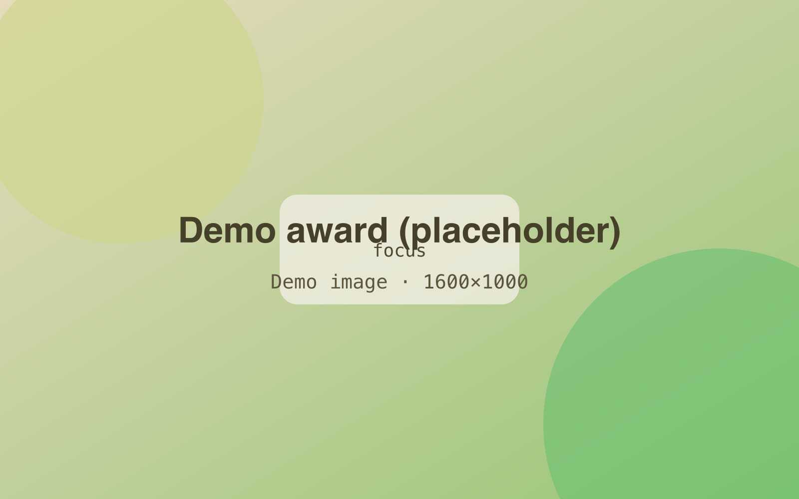

<!-- GENERATED from index.json by `npm run previews`. Do not edit; edit the entry instead. -->

# Demo award (placeholder)

A placeholder award with a page, a cover, and a highlight. Not a real award.

- **Status:** published
- **Kind:** award
- **Issuer:** Example Org
- **Date:** 2026-03-14
- **Projects:** demo-project-1, demo-project-2
- **Tags:** design
- **Links:** [Announcement (example)](https://example.com/awards/demo)
- **Featured:** yes
- **Cover:** 

## Highlight

A placeholder highlight for an achievement. Featured achievements share the home feed with projects.

[3D model: Demo board (placeholder 3D model)](./files/demo-model.glb)

## Body

This achievement has a body and a cover, so it gets its own page. Lorem ipsum dolor sit amet, consectetur adipiscing elit, sed do eiusmod tempor incididunt ut labore et dolore magna aliqua.

## Background

Ut enim ad minim veniam, quis nostrud exercitation ullamco laboris nisi ut aliquip ex ea commodo consequat. It links to [Demo project 1](project:demo-project-1).
