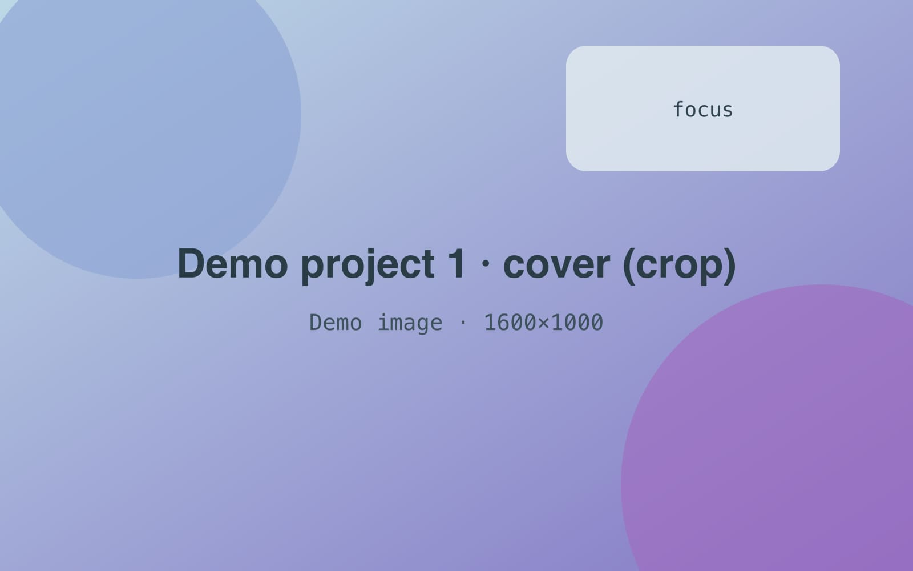
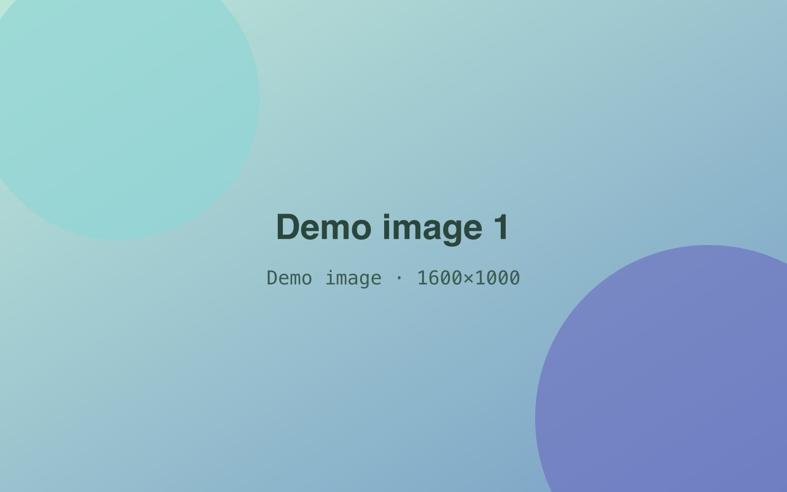
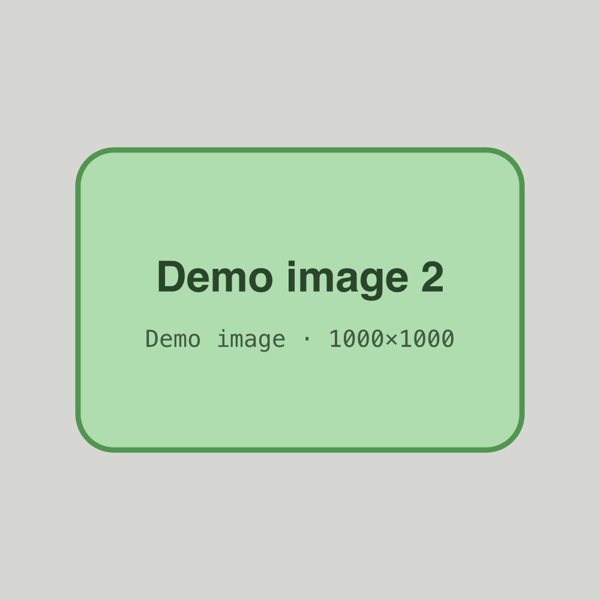
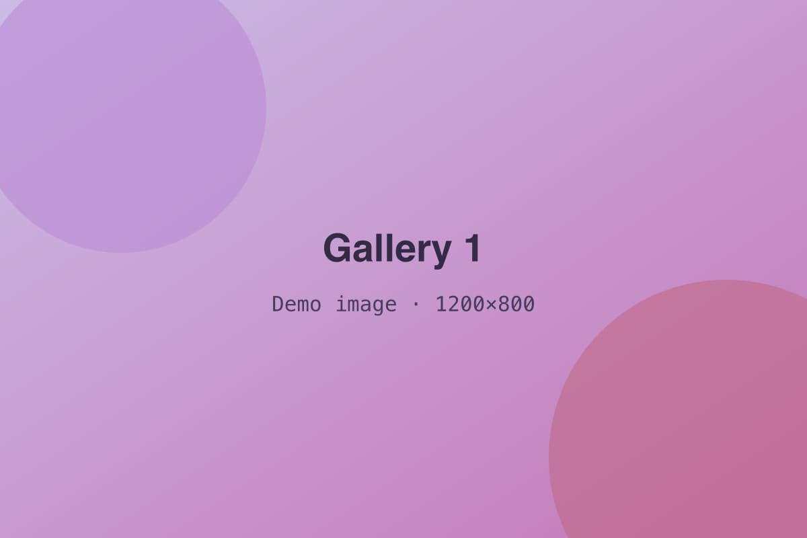
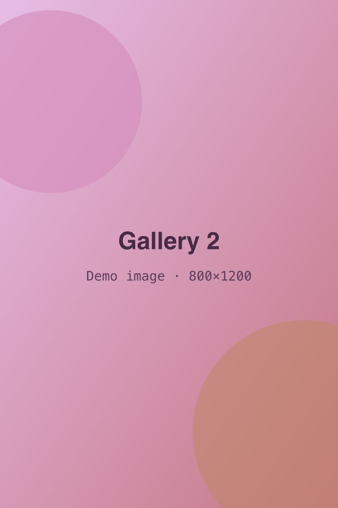
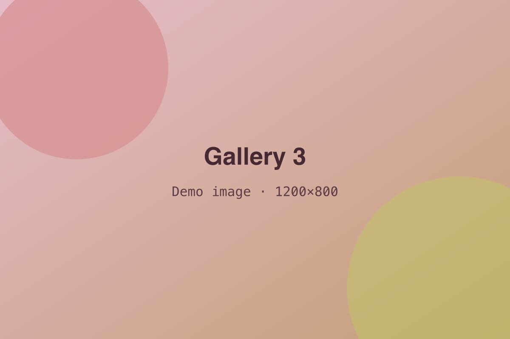

<!-- GENERATED from index.json by `npm run previews`. Do not edit; edit the entry instead. -->

# Demo project 1 — Featured, crop cover

A featured placeholder project with a highlight and a cropped cover. Its body uses text, lists, quotes, code, figures, and a gallery.

- **Status:** published
- **Dates:** 2026-05 – ongoing
- **Role:** Placeholder role
- **Tags:** software, web, design
- **Stack:** typescript, react, css
- **Links:** [Source (example)](https://code.example.com/demo-owner/demo-project-1), [Live demo (example)](https://example.com/demo-project-1)
- **Featured:** yes
- **Cover:** 

## Highlight

A short placeholder summary for the home **Highlights** feed. It is written separately from the body.

A second paragraph. Lorem ipsum dolor sit amet, consectetur adipiscing elit, sed do eiusmod tempor incididunt ut labore et dolore magna aliqua.


*The lead image of this highlight.*

[Embed: Example video embed (Big Buck Bunny)](https://www.youtube.com/embed/aqz-KE-bpKQ)

## Body

This is filler text for a demo entry. It shows **bold**, *italic*, `inline code`, a [plain link](https://example.com), and references to [Demo project 2](project:demo-project-2) and [the demo award](achievement:demo-award-placeholder). You can also combine ***bold italic*** text.

## Overview

Lorem ipsum dolor sit amet, consectetur adipiscing elit, sed do eiusmod tempor incididunt ut labore et dolore magna aliqua. Ut enim ad minim veniam, quis nostrud exercitation ullamco laboris nisi ut aliquip ex ea commodo consequat.


*A figure with no frame. Captions can hold *italic* text.*

### Ordered steps

1. First placeholder step.
2. Second placeholder step, with **bold** text.
3. Third placeholder step.

### Unordered notes

- An unordered item.
- Another item, with *italic* text.
- A third item, with `code`.

> A placeholder quotation that stands in for something someone once said about this demo.
> — Example Person, Example Org

## Code

Duis aute irure dolor in reprehenderit in voluptate velit esse cillum dolore eu fugiat nulla pariatur.

```ts
export function add(a: number, b: number): number {
  return a + b;
}
```

```
A code block with no language.
```


*A figure in a pebble frame (seed 12).*


## Gallery


*First gallery image.*


*Second, tall.*



---

A closing paragraph after a divider. Ut enim ad minim veniam, quis nostrud exercitation ullamco laboris nisi ut aliquip ex ea commodo consequat.
