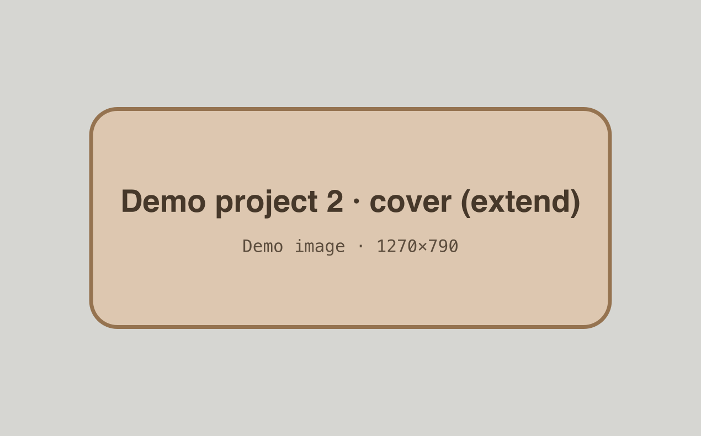
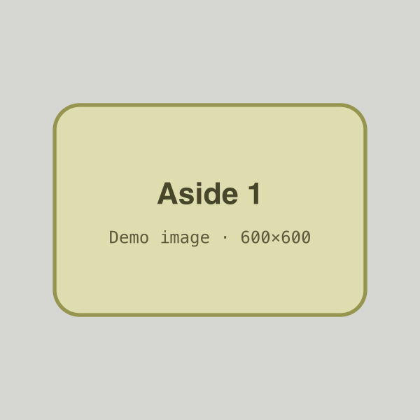
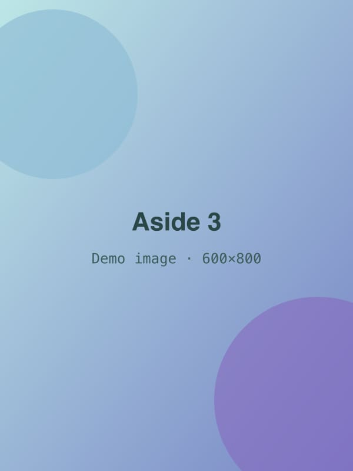
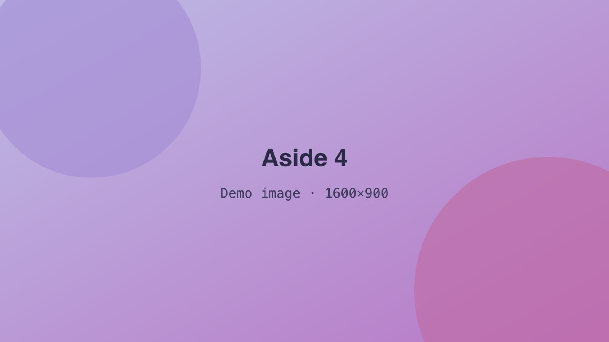
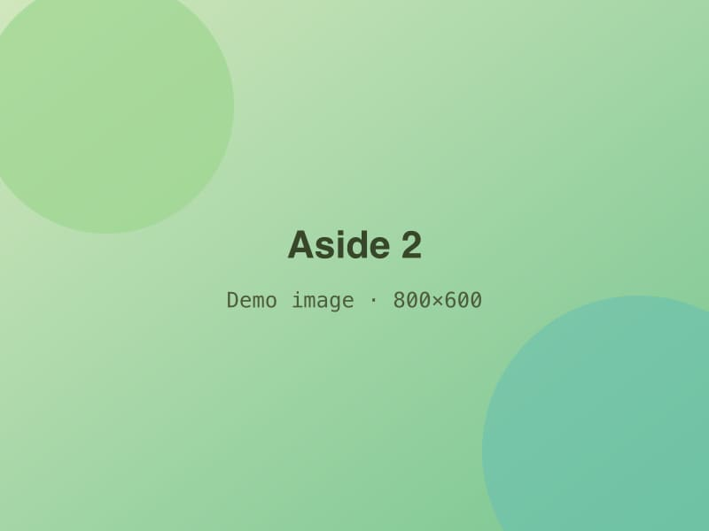

<!-- GENERATED from index.json by `npm run previews`. Do not edit; edit the entry instead. -->

# Demo project 2 — Featured, extend cover, no highlight

A featured placeholder project without a highlight, so the feed falls back to this summary and the cover. Its body shows asides at every side and size, ready to reorder or reframe with Arrange.

- **Status:** published
- **Dates:** 2025-09 – 2026-02
- **Role:** Demo lead (placeholder)
- **Tags:** hardware, robotics, embedded
- **Stack:** c, kicad, arduino
- **Links:** [Write-up (example)](https://example.com/demo-project-2)
- **Featured:** yes
- **Cover:** 

## Body

Try Edit body → Arrange to drag these blocks into a new order, or press New frame on a bubble to give it a new pebble shape. Asides (bubbles) sit beside the text on the left or right, or between paragraphs in the centre. They come in five sizes, xs to xl, and hold images, text, quotes, or stats. Lorem ipsum dolor sit amet, consectetur adipiscing elit, sed do eiusmod tempor incididunt ut labore et dolore magna aliqua.

> *Aside (left):*
>
> A text-only aside, extra small, on the left.

Lorem ipsum dolor sit amet, consectetur adipiscing elit, sed do eiusmod tempor incididunt ut labore et dolore magna aliqua. Ut enim ad minim veniam, quis nostrud exercitation ullamco laboris nisi ut aliquip ex ea commodo consequat. Duis aute irure dolor in reprehenderit in voluptate velit esse cillum dolore eu fugiat nulla pariatur.

> *Aside (right):*
>
> 
> *Small, right, with an image.*

Ut enim ad minim veniam, quis nostrud exercitation ullamco laboris nisi ut aliquip ex ea commodo consequat. Duis aute irure dolor in reprehenderit in voluptate velit esse cillum dolore eu fugiat nulla pariatur. Lorem ipsum dolor sit amet, consectetur adipiscing elit, sed do eiusmod tempor incididunt ut labore et dolore magna aliqua.

## Medium and large

> *Aside (left):*
>
> 
>
> A medium aside can mix an image with a line of text.

Lorem ipsum dolor sit amet, consectetur adipiscing elit, sed do eiusmod tempor incididunt ut labore et dolore magna aliqua. Ut enim ad minim veniam, quis nostrud exercitation ullamco laboris nisi ut aliquip ex ea commodo consequat. Duis aute irure dolor in reprehenderit in voluptate velit esse cillum dolore eu fugiat nulla pariatur. Lorem ipsum dolor sit amet, consectetur adipiscing elit, sed do eiusmod tempor incididunt ut labore et dolore magna aliqua.

> *Aside (right):*
>
> > A quote in a large, unframed aside on the right.
> > — Example Person

Duis aute irure dolor in reprehenderit in voluptate velit esse cillum dolore eu fugiat nulla pariatur. Lorem ipsum dolor sit amet, consectetur adipiscing elit, sed do eiusmod tempor incididunt ut labore et dolore magna aliqua. Ut enim ad minim veniam, quis nostrud exercitation ullamco laboris nisi ut aliquip ex ea commodo consequat. Duis aute irure dolor in reprehenderit in voluptate velit esse cillum dolore eu fugiat nulla pariatur.

## Centred

Ut enim ad minim veniam, quis nostrud exercitation ullamco laboris nisi ut aliquip ex ea commodo consequat.

> *Aside (center):*
>
> 
> *Extra large and centred: text goes above and below it.*

Lorem ipsum dolor sit amet, consectetur adipiscing elit, sed do eiusmod tempor incididunt ut labore et dolore magna aliqua.

> *Aside (center):*
>
> - **12** Placeholder count
> - **3.5×** Example ratio (made up)

Duis aute irure dolor in reprehenderit in voluptate velit esse cillum dolore eu fugiat nulla pariatur.

> *Aside (right):*
>
> 

> *Aside (left):*
>
> A large text-only aside on the left. Ut enim ad minim veniam, quis nostrud exercitation ullamco laboris nisi ut aliquip ex ea commodo consequat.

Lorem ipsum dolor sit amet, consectetur adipiscing elit, sed do eiusmod tempor incididunt ut labore et dolore magna aliqua. Ut enim ad minim veniam, quis nostrud exercitation ullamco laboris nisi ut aliquip ex ea commodo consequat. Duis aute irure dolor in reprehenderit in voluptate velit esse cillum dolore eu fugiat nulla pariatur. Lorem ipsum dolor sit amet, consectetur adipiscing elit, sed do eiusmod tempor incididunt ut labore et dolore magna aliqua.
