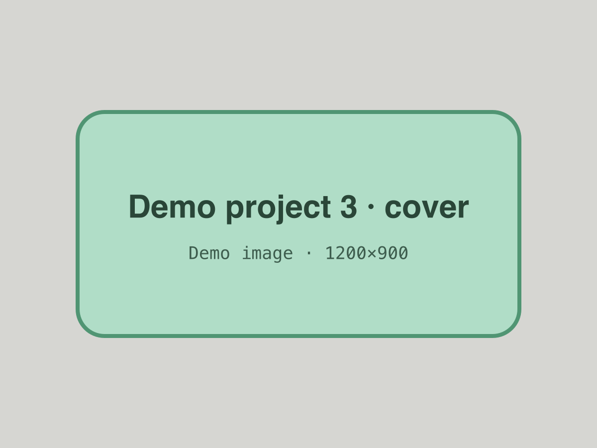

<!-- GENERATED from index.json by `npm run previews`. Do not edit; edit the entry instead. -->

# Demo project 3 — Callouts, stats, and files

A placeholder project with callouts in every tone, stat rows, and downloadable files in the body and the Files section.

- **Status:** published
- **Dates:** 2025-03-10 – 2025-06-30
- **Role:** Placeholder contributor
- **Tags:** data, research, testing
- **Stack:** python, postgresql, docker
- **Links:** [Paper (example)](https://example.com/papers/demo-project-3.pdf), [Video (example)](https://video.example.com/demo-project-3), [Source (example)](https://code.example.com/demo-owner/demo-project-3)
- **Cover:** 

## Body

Lorem ipsum dolor sit amet, consectetur adipiscing elit, sed do eiusmod tempor incididunt ut labore et dolore magna aliqua.

> **Note:** A **note** callout. Use it for context that's good to know.

> **Tip:** A **tip** callout, with a [link](https://example.com).
>
> Callouts can hold more than one paragraph.

> **Warning:** A **warning** callout, for things to be careful about.

## Numbers

- **42** Placeholder metric
- **7 ms** Example timing (sample value)
- **99%** Made-up rate
- **1.0** Version

- **1** A single stat

## Downloads

Files can sit in the body as well as in the Files section below.

[Spec sheet (PDF, placeholder)](./files/spec-sheet.pdf)

[Sample files (ZIP)](./files/sample-files.zip)

## Files

- [Spec sheet (PDF)](./files/spec-sheet.pdf)
- [Sample files (ZIP)](./files/sample-files.zip)
