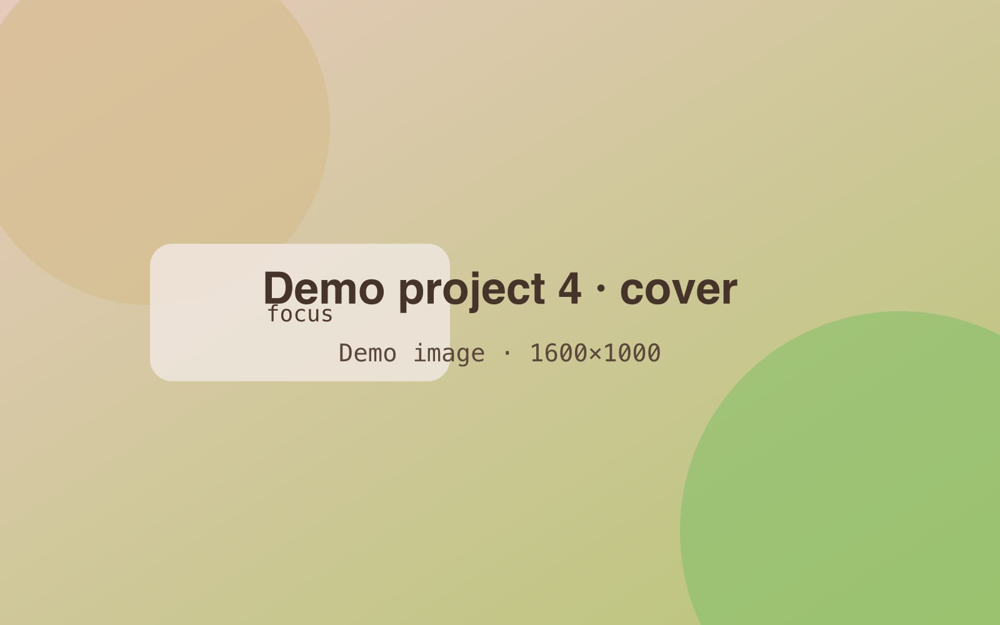

<!-- GENERATED from index.json by `npm run previews`. Do not edit; edit the entry instead. -->

# Demo project 4 — Demo, embed, and 3D model blocks

A featured placeholder project whose highlight leads with a playable demo. Its body has demo, embed, and 3D model blocks.

- **Status:** published
- **Dates:** 2024-11 – 2025-01
- **Role:** Placeholder developer
- **Tags:** web, software, open-source
- **Stack:** typescript, nodejs, react
- **Links:** [Play (example)](https://example.com/play), [Video (example)](https://video.example.com/demo-project-4)
- **Featured:** yes
- **Cover:** 

## Highlight

A placeholder highlight that leads with a playable demo. It records that it began as an AI draft that was then edited.

[Demo: Typing Race (sample demo)](/demos/typing-race/)

## Body

Interactive pieces load only when asked. Lorem ipsum dolor sit amet, consectetur adipiscing elit, sed do eiusmod tempor incididunt ut labore et dolore magna aliqua.

## Playable demo

The demo block plays one of this site's own apps, behind a Play button. This one is the Typing Race app.

[Demo: Typing Race (sample demo)](/demos/typing-race/)

The same demo without a poster, at the default shape:

[Demo: Typing Race, no poster](/demos/typing-race/)

## Embedded video

Embeds show an outside page, like a video player.

[Embed: Example video embed (Big Buck Bunny)](https://www.youtube.com/embed/aqz-KE-bpKQ)

[Embed: The same embed at 4:3](https://www.youtube.com/embed/aqz-KE-bpKQ)

## 3D model

The model block shows a GLB file in a 3D viewer that loads only when asked. This placeholder is a green board with a few coloured blocks.

[3D model: Demo board (placeholder 3D model)](./files/demo-model.glb)

The same model without a poster, at 16:10:

[3D model: Demo board, no poster](./files/demo-model.glb)
