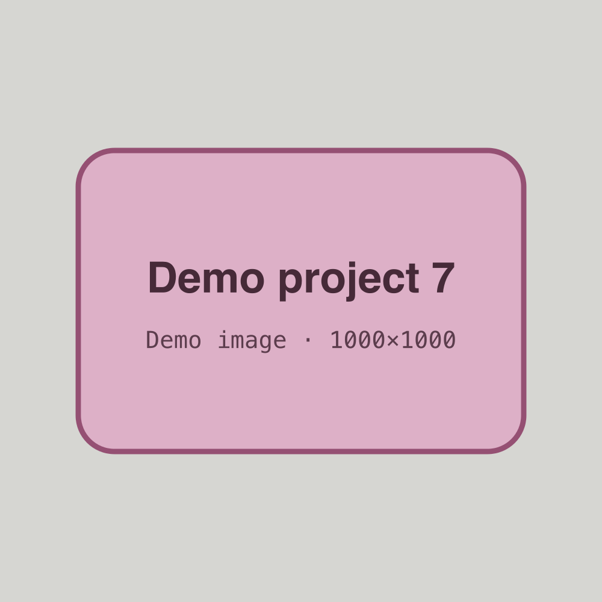

<!-- GENERATED from index.json by `npm run previews`. Do not edit; edit the entry instead. -->

# Demo project 7 — Learned list, no body

A placeholder project with a list of lessons and no body text.

- **Status:** published
- **Dates:** 2023-06 – 2023-08
- **Role:** Placeholder intern
- **Tags:** design, research
- **Stack:** figma, css
- **Links:** [Notes (example)](https://example.com/notes)
- **Cover:** 

## What I learned

- A first placeholder lesson, with *italic* text.
- A second lesson, with a link to [Demo project 5](project:demo-project-5).
- A third lesson.
