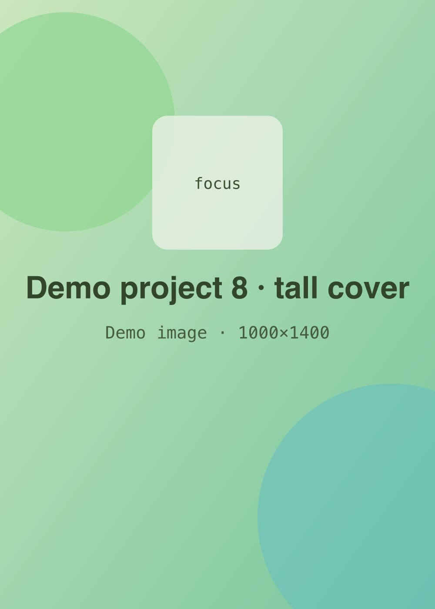

<!-- GENERATED from index.json by `npm run previews`. Do not edit; edit the entry instead. -->

# Demo project 8 — Tall cover, default fit

A placeholder project with a tall, busy cover and no fit chosen, so cards crop it around the focus point.

- **Status:** published
- **Dates:** 2023-01 – 2023-04
- **Tags:** hardware, testing
- **Stack:** python, arduino
- **Cover:** 

## Body

Lorem ipsum dolor sit amet, consectetur adipiscing elit, sed do eiusmod tempor incididunt ut labore et dolore magna aliqua.
