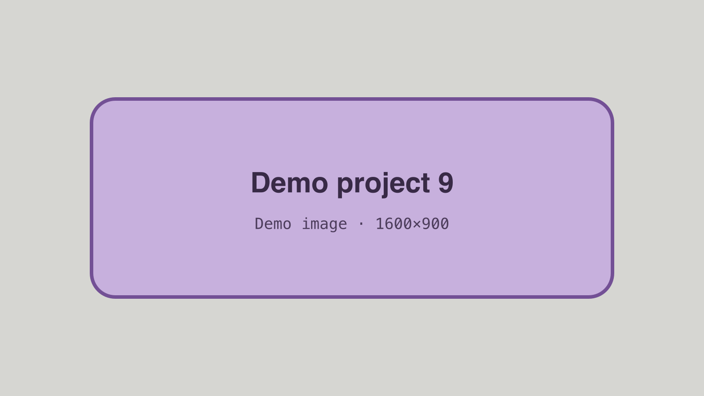

<!-- GENERATED from index.json by `npm run previews`. Do not edit; edit the entry instead. -->

# Demo project 9 — Many tags

A placeholder project tagged with almost everything, so the filter row fills up and overflows.

- **Status:** published
- **Dates:** 2022 – 2023
- **Role:** Placeholder generalist
- **Tags:** hardware, software, robotics, web, embedded, data, design, research, tooling, testing, audio, open-source, teaching
- **Stack:** typescript, python, c, rust, react, nodejs, postgresql, docker, linux, figma, kicad, arduino, git, css
- **Links:** [Source (example)](https://code.example.com/demo-owner/demo-project-9)
- **Cover:** 

## Body

Lorem ipsum dolor sit amet, consectetur adipiscing elit, sed do eiusmod tempor incididunt ut labore et dolore magna aliqua.

See also [Demo project 1](project:demo-project-1).
